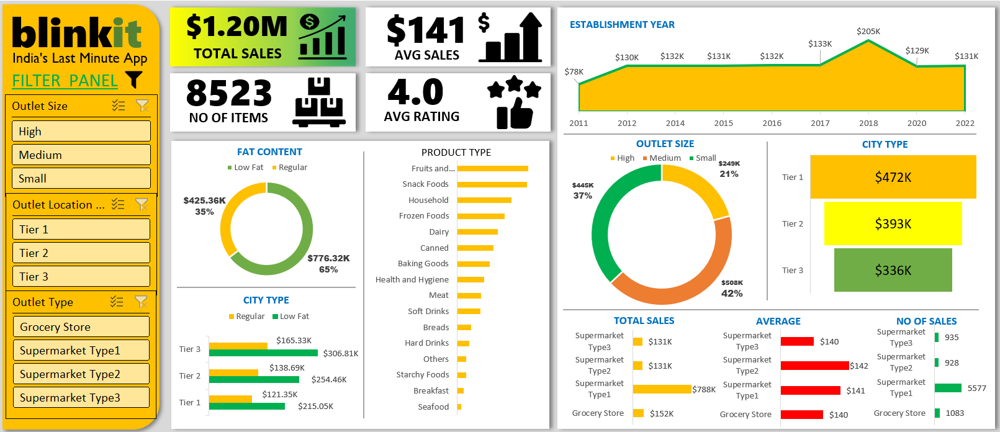
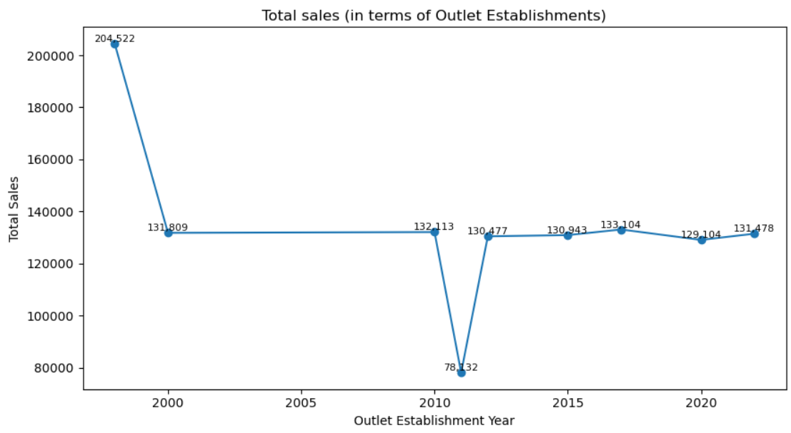
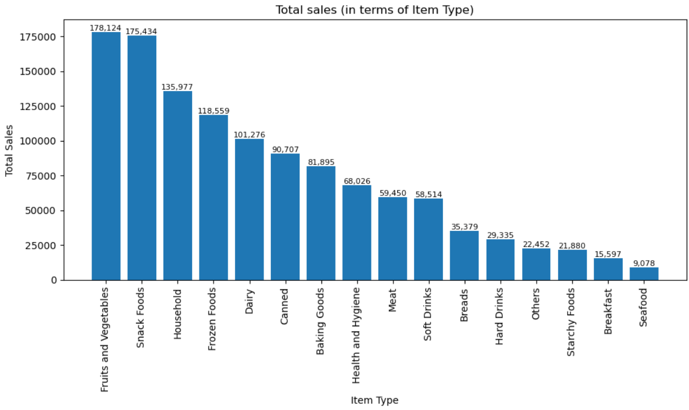
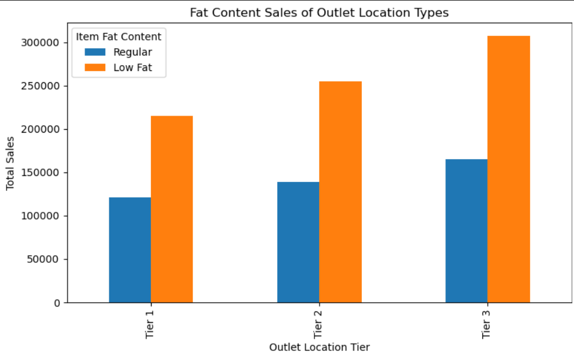

# 🛒 Blinkit Sales Analytics Dashboard (Power BI)


An end-to-end data analytics project analyzing Blinkit's (quick commerce) retail sales performance, customer satisfaction ratings, inventory visibility, and outlet attributes across different geographical locations.

---

## 📌 Project Overview

The objective of this project is to conduct a comprehensive data analysis of Blinkit's sales operations to extract actionable insights. Using **Power BI**, interactive dashboards were built to track key performance indicators (KPIs) and evaluate how outlet type, size, location tier, and product characteristics drive total revenue.

---

## 🖼️ Demo
  

 


## 📊 Key Metrics & KPIs Tracked

- **Total Sales:** Overall revenue generated across all outlets.
- **Average Sales:** Mean transaction value per sale.
- **Number of Items Sold:** Total item volume across all product lines.
- **Average Customer Rating:** Customer satisfaction score categorized by product category and outlet.
- **Fat Content Breakdown:** Sales distribution across Low Fat vs. Regular items.
- **Outlet Tier Performance:** Revenue breakdown across Tier 1, Tier 2, and Tier 3 cities.
- **Outlet Size & Type Analysis:** Comparison of Grocery Stores vs. Supermarket Types 1, 2, and 3.

---

## 🛠️ Tech Stack & Skills

- **Tool:** Microsoft Power BI Desktop
- **Data Modeling:** Star Schema / Relational Data Model
- **Calculations:** DAX (Data Analysis Expressions) for custom KPIs and measures
- **Data Transformation:** Power Query for ETL, data cleansing, and data validation
- **Visualization:** Matrix tables, bar charts, donut charts, area maps, and KPI card visuals

---

## 📁 Repository Structure

```text
├── Data/                   # Raw & Cleaned Dataset (CSV / Excel)
├── Dashboard/              # Power BI Desktop File (.pbix)
├── Screenshots/            # Dashboard preview images
└── README.md               # Project documentation
